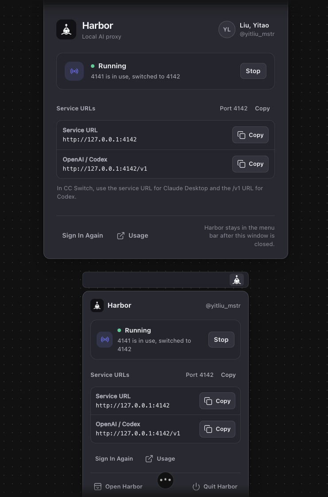

#  Harbor

Harbor is a macOS menu bar app that signs in with GitHub and runs a local AI service for compatible clients. The bundled runtime means users do not need to install Node.js or Bun.

Opening Harbor shows a control window. Closing it keeps Harbor in the menu bar; select the Harbor status item and choose “Open Harbor” to bring the window back.
Only one Harbor instance runs per user. Opening another instance brings the existing window forward.

## Requirements

- macOS 14 or later
- Apple Silicon

## Menu

- Start and stop the server on `127.0.0.1:4141`
- Sign in with the GitHub device flow
- View Copilot plan and quota usage in Harbor while the server is running
- See the percentage of premium requests used beside the menu bar icon
- Quit, which also stops the server started by Harbor

If another process already uses port 4141, Harbor reports the conflict and leaves that process alone.

Harbor stores the GitHub sign-in credential locally for the service.

## UX specification



*Original design reference; current versions show Copilot usage inside Harbor.*

### Product goal

Harbor gives users a small, native macOS control surface for signing in, starting or stopping a local AI service, and configuring compatible clients. Core status and usage information stay inside Harbor.

### Main window and menu bar

- Launching Harbor opens the main control window and adds a persistent status item to the menu bar.
- The window and menu bar popover show the same account and service state. Closing the window leaves Harbor running in the menu bar.
- The popover provides **Open Harbor** and **Quit Harbor** actions. Quit also stops the service started by Harbor.
- Only one Harbor process runs per user. Opening another copy brings the existing window forward.

### Sign-in and service states

- **Signed out:** show the signed-out state and a primary sign-in action. GitHub device authorization displays the user code and lets the user open the authorization page or cancel.
- **Signed in, stopped:** show the account and a primary start action.
- **Starting or failed:** show progress or a concise error while keeping the relevant recovery action available.
- **Running:** show a clear running indicator, a stop action, and copyable local service URLs. If the preferred port is occupied, use the next available port and explain the change without stopping the other process.

### Copilot usage

- While the service is running, show a usage card in both the main window and menu bar popover.
- Display the account plan, quota reset time, and available premium request, chat, and completion quotas as used/total values with remaining percentages.
- Load usage automatically when the service starts, refresh it periodically, and provide an in-place refresh action. Loading and unavailable states remain inside Harbor; usage never opens a separate web page.

### Endpoints and presentation

- Present the local service URL and the `/v1` compatible URL in separate rows with one-click copy actions.
- Use a compact native layout that follows macOS appearance colors, with consistent spacing and clear status color and icon pairing. Keep account identity secondary to service status and actions.
- Localize user-facing text for English and Chinese. Give icon-only actions accessible labels and retain selectable endpoint text.

## Build

Building requires Xcode command line tools, Node.js 20.18.1 or later, and npm 9 or later. The
first build downloads pinned runtime dependencies from npm; npm verifies their
integrity using `Runtime/package-lock.json`.

```sh
scripts/build-app.sh
```

The script prepares the runtime in `.build/harbor-runtime`, builds the release binary, assembles `dist/Harbor.app`, and ad-hoc signs it. Copy that app to `/Applications`.

Bundled in the application:

- Bun 1.4.4 for darwin-aarch64
- The local service runtime and its pinned dependencies

For `swift run`, first run `scripts/prepare-runtime.sh` to prepare the local runtime.

Run the UI state checks with `scripts/test-view-state.sh`.

## License

This project is licensed under the [MIT License](LICENSE).
